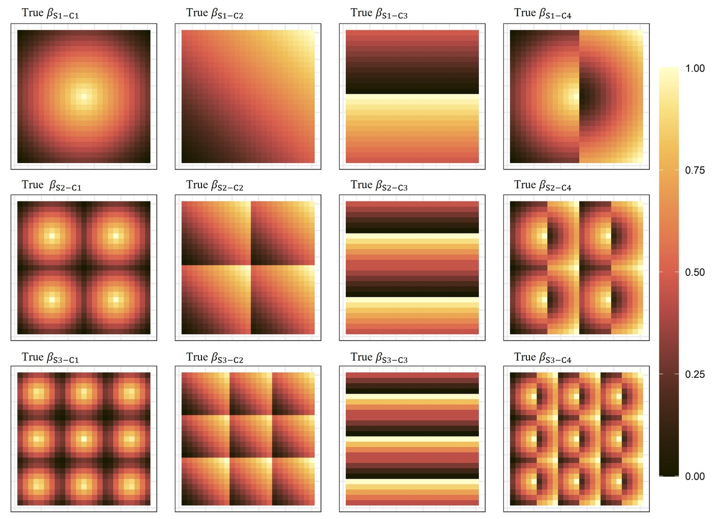
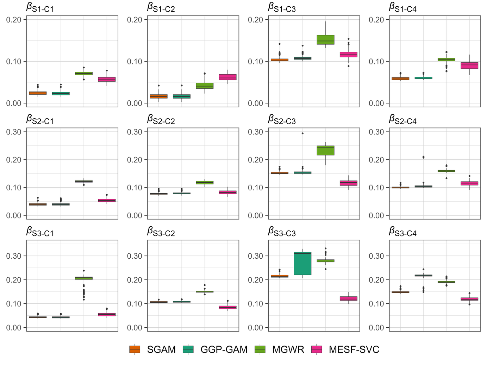
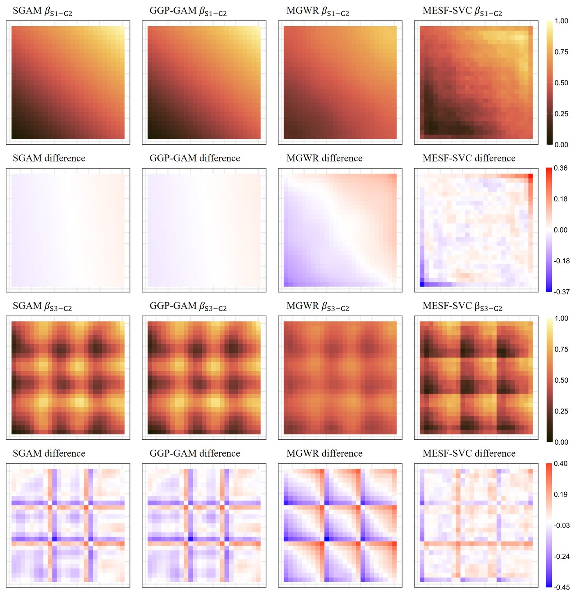
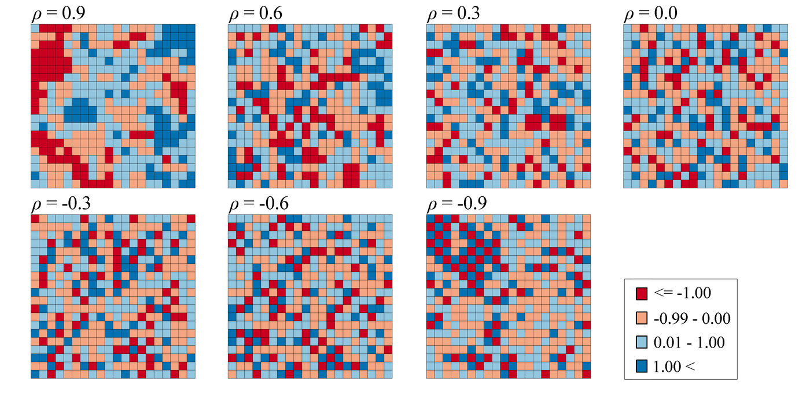
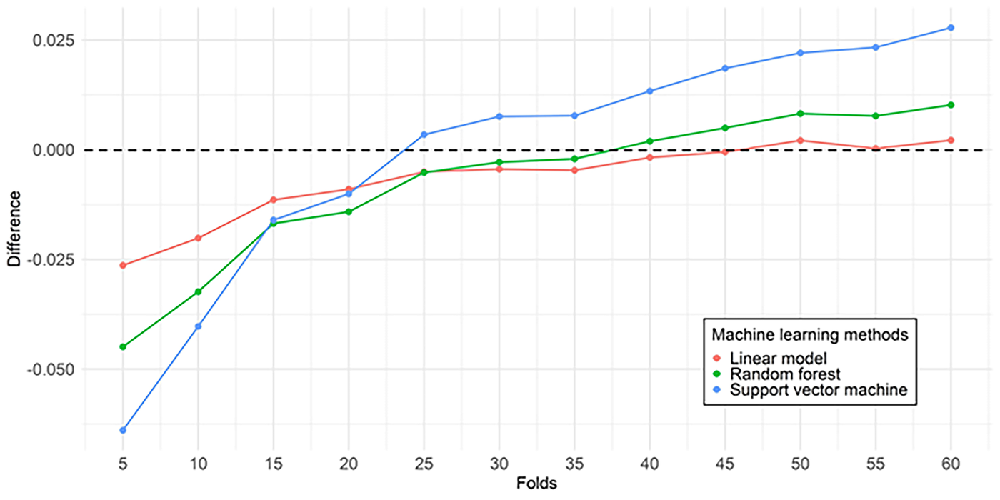
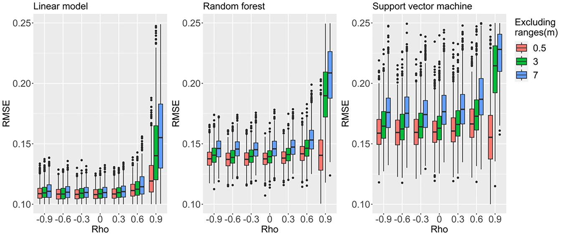

## Funded Research

### Comparative analysis of varying local regression models according to spatial heterogeneity patterns

**Principal Investigator** · Ph.D. Student Research Grant \
Ministry of Education, Korea · 2025 – 2026

::: {layout-ncol=3}

:::

### Developing machine learning methods incorporating spatial data properties

**Student Researcher** · Excellent Young Researcher Program \
Ministry of Science and ICT, Korea · 2022 – 2024

::: {layout-ncol=3}

:::

## Commissioned Research

**112신고에 영향을 미치는 주요 요인 및 상관관계 분석 연구용역** \
연구보조원 · 치안정책연구소 · 2026.04 – 2026.10

**시공간적 변동 원천에 따른 기계학습을 결합한 시공간 크리깅의 평가** \
연구보조원 · 서울시립대학교산학협력단 · 2025.03 – 2026.02

**지역 기반 불연속적 공간적 이질성 탐색** \
연구보조원 · 서울시립대학교산학협력단 · 2024.06 – 2025.05

**공간적 입력변수를 활용한 기계학습 개선** \
연구보조원 · 서울시립대학교산학협력단 · 2023.06 – 2024.05

**공간정보의 이해와 활용에 관한 도서 발간 용역** \
연구보조원 · LX한국국토정보공사 · 2022.11 – 2023.06

## Professional Experience

**Researcher** · Spatial and Environmental Research Division \
Chungnam Institute, Korea · 2019 – 2021